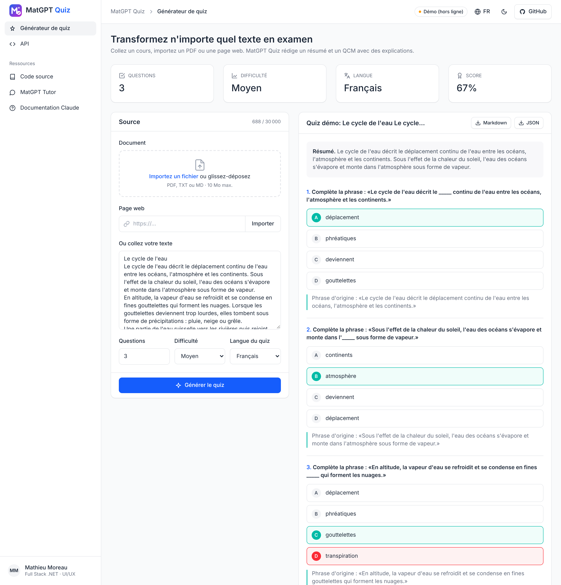
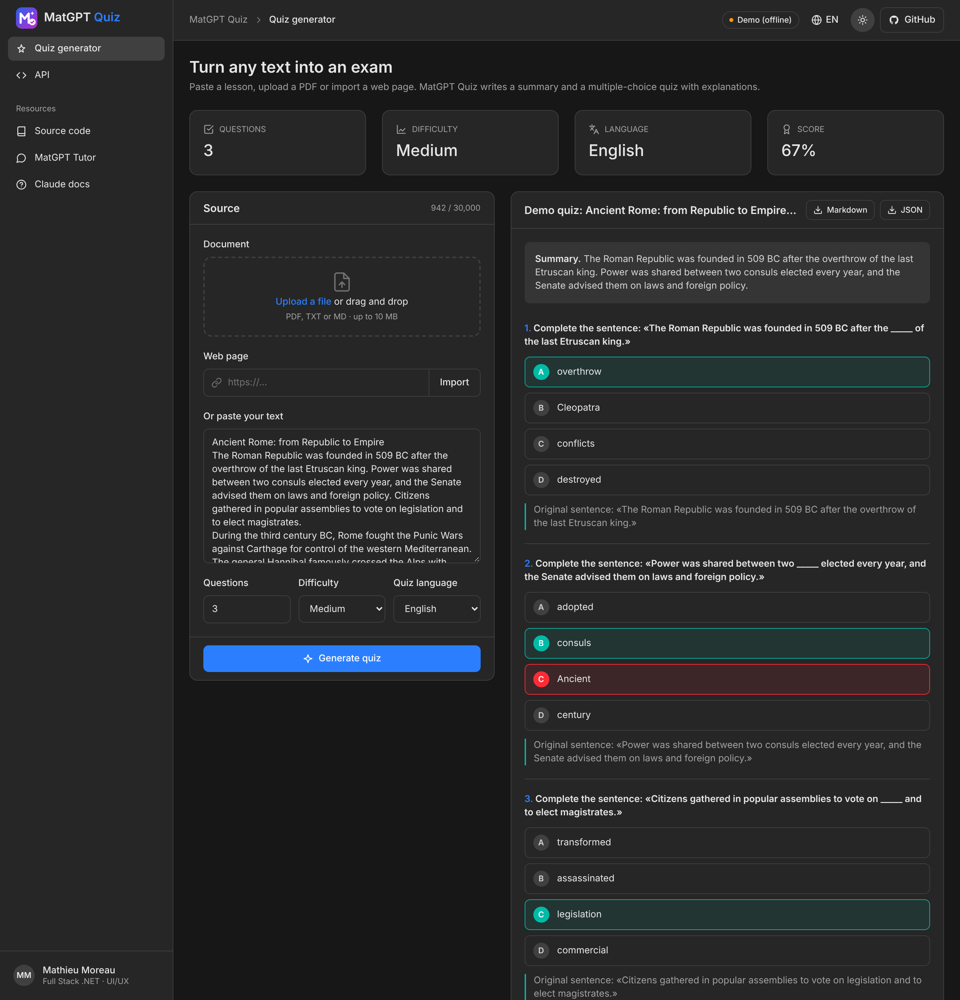
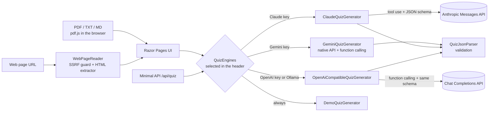

# MatGPT Quiz

**Turn any text into a multiple-choice exam with AI.**
Paste a lesson, an article or your notes: MatGPT Quiz writes a short summary and builds a quiz with explanations, ready to take online or export for a class.

Built with **ASP.NET Core (.NET 10)**, your choice of AI (**Claude, ChatGPT, Gemini or a local Ollama model**) and a dashboard UI made with **Tailwind CSS + Preline UI** (light and dark mode).



<details>
<summary>Dark mode</summary>



</details>

## Features

- 📝 Generate 1 to 20 multiple-choice questions from any text: paste it, or drop a **PDF**, `.txt` or `.md` file
- 📄 PDF text extracted in the browser with pdf.js: documents are never stored on the server
- 🌐 Import any public **web page** by URL: the main content is extracted, menus and footers are dropped
- 🗣️ Interface in **English, Français, Español and Català** (ASP.NET Core localization with `.resx` files)
- 🎯 Three difficulty levels and four languages (English, Spanish, French, Catalan)
- 📚 Automatic summary of the source text
- ✅ Interactive quiz: answer, check, see your score and the explanation of each question
- 📤 Export to **Markdown** (with answer key, ready to print) or **JSON**
- 🔌 JSON API (`POST /api/quiz`) for other applications
- 🌗 Responsive admin-dashboard layout with dark mode (Preline UI)
- 🤖 **Choose your AI**: Claude, ChatGPT, Gemini or Ollama (free, local) from a selector in the header; each engine appears once its key is configured
- 🧪 **Offline demo mode**: works without an API key, so anyone can try it in one command

## How it works



Technical choices worth noting:

- **Structured output with tool use.** The model is forced to call a `create_quiz` tool whose JSON schema matches the domain model (Claude tool use, or OpenAI-style function calling for ChatGPT, Gemini and Ollama). No fragile text parsing.
- **Pluggable AI engines.** `QuizEngines` is a registry of the configured providers; the header selector stores the choice in a cookie. One `OpenAiCompatibleQuizGenerator` covers ChatGPT and Ollama; `GeminiQuizGenerator` uses Gemini's native API (works with the new `AQ.` keys).
- **Never trust the model.** `QuizJsonParser` validates every field (4 distinct options, valid `correctIndex`, non-empty explanation) and turns problems into clear error messages.
- **Prompt-injection guard.** The source text is wrapped in `<document>` tags and treated as data, not instructions.
- **Clean architecture.** `Core` has no dependencies (models, prompts, parsing, export); `Infrastructure` holds the AI providers behind `IQuizGenerator`, so a new provider is a new class, not a rewrite (that is how ChatGPT, Gemini and Ollama were added).
- **SSRF protection for web import.** Only http/https; every connection, including redirects, is checked at socket level: localhost, private networks and cloud metadata addresses (`169.254.169.254`) are blocked. Size and time limits too.
- **Localization the .NET way.** `IStringLocalizer` + `.resx` resources, culture stored in the standard ASP.NET Core cookie, validation errors returned as codes so each language gets its own message.
- **Cost protection.** Built-in ASP.NET Core rate limiting (10 generations/minute per IP) and input size limits.
- **Secrets stay secret.** The API key comes from user-secrets or an environment variable, never from the repository.

## Project structure

```
src/
  QuizForge.Core/            Domain models, validation, prompts, JSON parsing, Markdown export
  QuizForge.Infrastructure/  Claude and OpenAI-compatible generators (HttpClient), engine registry, offline demo generator, DI setup
  QuizForge.Web/             Razor Pages UI, minimal API, rate limiting, health check
    Resources/               UI translations: SharedResource.resx (en), .fr, .es, .ca
    Styles/                  Tailwind CSS source (app.css) + vendor copy script
    wwwroot/                 Built CSS, JS, Preline and pdf.js (committed: no Node needed to run)
tests/
  QuizForge.Tests/           xUnit tests (parser, validator, prompts, exporter, generators)
```

## Getting started

Requirements: [.NET 10 SDK](https://dotnet.microsoft.com/download) or Docker.

```bash
git clone https://github.com/MathieuMoe/ai-quiz-generator.git
cd ai-quiz-generator
dotnet run --project src/QuizForge.Web
```

The app starts in **demo mode**. Add one or more AI keys (stored with user-secrets, never in the repo); every configured engine appears in the header selector:

```bash
# Claude  - https://console.anthropic.com/
dotnet user-secrets set "Claude:ApiKey" "sk-ant-..." --project src/QuizForge.Web
# ChatGPT - https://platform.openai.com/api-keys
dotnet user-secrets set "OpenAI:ApiKey" "sk-..." --project src/QuizForge.Web
# Gemini (free tier available) - https://aistudio.google.com/apikey
dotnet user-secrets set "Gemini:ApiKey" "AQ...." --project src/QuizForge.Web
# Ollama (free, runs on your machine) - https://ollama.com, then: ollama pull llama3.2
dotnet user-secrets set "Ollama:Enabled" "true" --project src/QuizForge.Web
# Optional: engine selected by default
dotnet user-secrets set "Ai:Default" "gemini" --project src/QuizForge.Web
```

### With Docker

```bash
OPENAI_API_KEY=sk-... docker compose up --build   # or ANTHROPIC_API_KEY / GEMINI_API_KEY
# open http://localhost:8080
```

### Configuration

| Setting | Default | Description |
|---|---|---|
| `Ai:Default` | first configured | Default engine: `claude`, `openai`, `gemini`, `ollama` or `demo`. |
| `Claude:ApiKey` / `ANTHROPIC_API_KEY` | – | Enables Claude. |
| `Claude:Model` | `claude-sonnet-4-5` | Any model from the [models list](https://docs.claude.com/en/docs/about-claude/models). |
| `Claude:MaxTokens` | `4096` | Maximum answer size. |
| `OpenAI:ApiKey` / `OPENAI_API_KEY` | – | Enables ChatGPT. `OpenAI:Model` defaults to `gpt-5-mini`. |
| `Gemini:ApiKey` / `GEMINI_API_KEY` | – | Enables Gemini. `Gemini:Model` defaults to `gemini-flash-latest`. |
| `Ollama:Enabled` | `false` | Enables a local Ollama model (`Ollama:Model`, `Ollama:BaseUrl`). |
| `WebImport:AllowPrivateNetworks` | `false` | Allows importing pages from localhost / private networks. Development only. |

## Front-end (optional)

The compiled CSS and the vendor files are committed, so **Node.js is only needed to change the design**:

```bash
cd src/QuizForge.Web
npm install
npm run build        # copies Preline + pdf.js to wwwroot/lib and builds wwwroot/css/site.css
npm run watch:css    # rebuilds the CSS while you edit .cshtml files
```

## API

```bash
curl -X POST http://localhost:5180/api/quiz \
  -H "Content-Type: application/json" \
  -d '{ "sourceText": "…at least 200 characters…", "questionCount": 5, "difficulty": "Medium", "language": "Spanish" }'
```

Returns the quiz as JSON (`title`, `summary`, `questions[]` with `options`, `correctIndex`, `explanation`).

```bash
curl -X POST http://localhost:5180/api/import-url \
  -H "Content-Type: application/json" \
  -d '{ "url": "https://en.wikipedia.org/wiki/Photosynthesis" }'
```

Returns the readable text of the page (`title`, `text`, `url`, `truncated`), ready to send to `/api/quiz`.

## Tests

```bash
dotnet test
```

CI runs the build and the tests on every push (GitHub Actions).

## Roadmap

- [x] PDF upload
- [x] Web page import
- [x] Interface in 4 languages
- [ ] Word (.docx) upload
- [ ] OCR for scanned PDFs
- [x] ChatGPT, Gemini and Ollama providers, chosen in the interface
- [ ] Save quizzes and share them with a link
- [ ] Open questions with AI-assisted grading

## Credits

- [Preline UI](https://preline.co/) (MIT) and [Tailwind CSS](https://tailwindcss.com/) (MIT) for the design system
- [pdf.js](https://mozilla.github.io/pdf.js/) by Mozilla (Apache 2.0) for PDF text extraction

## Author

**Mathieu Moreau**, Full Stack .NET Developer & UI/UX Designer
[LinkedIn](https://www.linkedin.com/in/mathieu-moreau-045b26114/) · [GitHub](https://github.com/MathieuMoe)

Licensed under the [MIT License](LICENSE).
